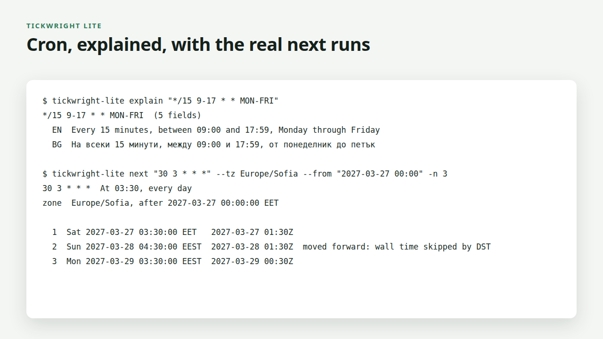

# Tickwright Lite by PN Scripts

A free command-line tool (MIT) that checks cron expressions before they reach
a server: it validates an expression, explains it in plain English and
Bulgarian, and lists the next run times in any time zone, correct across
daylight-saving changes.



## Install

- **Binaries**: download the archive for your platform from GitHub Releases
  (Linux, macOS, Windows; amd64 and arm64), unpack, put `tickwright-lite` on
  your `PATH`. Verify with `sha256sum -c SHA256SUMS`.
- **Docker**: `docker run --rm pnscripts/tickwright-lite explain "0 9 * * 1-5"`
- **Go**: `go install github.com/pnscripts/tickwright-lite/cmd/tickwright-lite@latest`

## Usage

```
tickwright-lite validate "0 9 * * 1-5"                  # exit 0 valid, 1 invalid
tickwright-lite explain  "*/15 9-17 * * MON-FRI"        # EN and BG
tickwright-lite explain  "@weekly" --lang bg
tickwright-lite next     "30 3 * * *" --tz Europe/Sofia -n 5
tickwright-lite next     "0 0 * * *" --tz America/New_York --from "2026-11-01 00:00" --json
```

- Syntax: 5 fields, 6 fields (seconds first), `@yearly @annually @monthly
  @weekly @daily @midnight @hourly`, lists, ranges, steps, `JAN-DEC`,
  `SUN-SAT`, `0` and `7` for Sunday, `?` in day fields. Quartz `L`, `W`, `#`
  and robfig `@every` are rejected with an explanation.
- Daylight saving follows classic Vixie cron: a skipped wall time runs moved
  forward by the gap; a repeated wall time runs once (hourly jobs run in both
  copies of the repeated hour). `next` marks such runs.
- `--json` on every command, `--color auto|always|never` (honours
  `NO_COLOR`), exit codes 0 ok, 1 invalid, 2 usage error.
- Single static binary with the time zone database embedded.

The full edition, Tickwright, adds `lint` (day-of-month and day-of-week both
set, impossible dates, DST traps and more) and `compare` (are two expressions
equivalent, checked over a full 400-year cycle):
https://pnscripts.com/marketplace/cli-tickwright. Lite is complete on its own.

## Build and test

```
make test     # go vet + go test (Go 1.22+, no third-party modules)
make dist     # dist/*.tar.gz, *.zip and SHA256SUMS for a GitHub release
docker build -t pnscripts/tickwright-lite .
```

## Licence

MIT. Copyright (c) 2026 ПН СКРИПТС ЕООД (PN Scripts).
